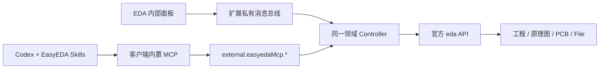

# EDA 内部 .eext 扩展设计

用户确认“希望做 EDA 内部 .eext 扩展”。主交付位于 easyeda-mcp/extension，运行在嘉立创 EDA 专业版中。已有 Python stdio 试作保留，不作为此需求的完成证明。Agent 插件继续使用内置 MCP；不增加 WebSocket 或独立 MCP 服务。

14 个接口覆盖工程与能力读取、器件检索、器件/引脚/网表读取、DRC、原理图放置及按引脚连线、PCB 放置/自动布局/自动布线、显式保存、制造导出。启动仅注册接口，不打开工程、不写入。默认只读，菜单或面板经过一次 EDA 用户确认才开启当前扩展会话的工程修改；外部 API 参数不能设置该开关。

操作使用明确 projectUuid/documentUuid，调用前及批次每次写入前校验活动目标。部分批次失败时返回已创建对象，不自动回滚或重放。编辑器没有提供本包可用的事务锁，执行中切换图页仍需避免。原理图连线按真实 pin 端点构造正交路径，不承诺自动避障。

制造导出支持 base64、客户端保存窗口、客户端文件系统三种方式。文件系统写入 force=false，禁止覆盖；写入后回读全部字节，失败保留已落盘路径。保存窗口只报告 download_requested；不会把取消对话框当成已经写入。Gerber 默认层与对象来自当前客户端，仍需预览铜层、板框和钻孔。文件上限 10MiB。

开发采用 SDK 1.6.29 固定修订，项目内安装 pro-api-types 0.4.26 与 TypeScript 5.9.3；不安装全局 CLI、不创建 Git 分支、不初始化规格体系。build/ 与 config/ 的 Node API 仅用于打包，主扩展 src/ 不使用 Node/DOM。

验收：类型闭包查询、tsc、浏览器 IIFE bundle 的隔离执行、工作流测试、eext 内容/CRC/manifest/菜单/接口检查。安装到用户 EDA 需要用户规则中的插件安装授权；安装后先验证发现和只读工程读取。真实工程写入、布线、DRC 和制造导出单独验收，不以打包或 mock 测试代替。
